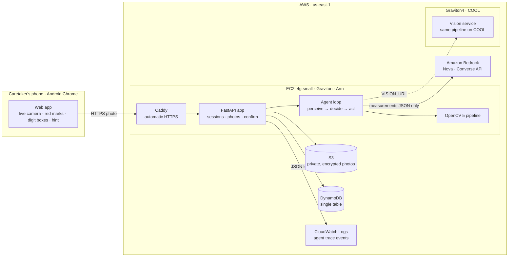
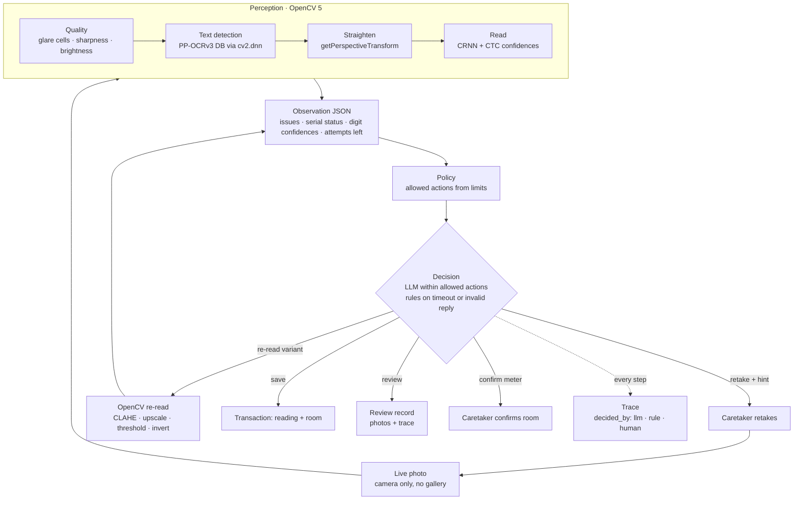

# MeterMind — agentic meter reading with OpenCV 5 on AWS

[](https://github.com/AlgoMasterArpit/openCV/actions/workflows/ci.yml)


**Entry for the OpenCV AI Competition 2026, powered by AWS.** Paths: **Agentic Vision** (and Best Use of COOL, see [status](#status)).

A caretaker photographs a utility meter on a phone. **OpenCV 5 measures the photo** — glare and where it is, sharpness, the meter's serial, every digit and its confidence — and an **agent decides what to do next**: ask for a retake with an exact hint, catch the wrong meter, re-read an unclear digit with a different OpenCV variant, send the case to human review, or save the reading. The visual evidence changes the next action every time, and every step is traced.

<p>
  
  
  
</p>

---

## Contents

[Problem and impact](#problem-and-impact) · [What it does](#what-it-does) · [Architecture on AWS](#architecture-on-aws) · [Agentic workflow](#agentic-workflow) · [OpenCV 5 implementation](#opencv-5-implementation) · [Evidence: vision changes the next action](#evidence-vision-changes-the-next-action) · [Evaluation](#evaluation) · [COOL on Graviton](#cool-on-graviton) · [Run it](#run-it) · [Responsible use](#responsible-use-and-limits) · [Status](#status)

## Problem and impact

India still reads water, gas and building sub-meters by eye, and where photo proof is required, the photo itself can be faked:

- A Pune society got a **₹24 lakh** water bill after months without readings, because the corporation lacked meter readers ([Punekar News](https://www.punekarnews.in/pune-society-shocked-by-rs-24-lakh-water-bill-amid-pmc-meter-reader-shortage/)).
- Delhi Jal Board made **photo proof mandatory** for every reading ([Outlook](https://www.outlookindia.com/national/corrupt-water-meter-readers-to-face-firs-delhi-jal-board-news-218167)).
- An Odisha meter reader faced an FIR for **editing the reading and removing the meter number** in photos ([TP Southern Odisha](https://tpsouthernodisha.com/press-releases/FIR_Registered_in_Boudh)).

Utilities receive these photos by the million and nobody checks them automatically. Electricity is moving to smart meters; water, gas and sub-meters are not, so the photo stays the only proof.

**Users:** a hostel caretaker on a monthly meter round (the demo), utility meter readers, and housing-society managers. **Beneficiaries:** residents billed on real use instead of averages, and auditors who get evidence instead of a number.

## What it does

| Situation | OpenCV 5 evidence | Agent action |
| --- | --- | --- |
| Glare, blur, darkness | Saturated pixels per 3×3 cell, Laplacian sharpness, V-channel brightness | Red marks on the photo + one exact hint: *"Upar right mein glare hai, phone thoda left tilt karo."* |
| Another room's meter | Serial from DB text detection + CRNN, matched to the registered meter | *"Ye Room 205 ka meter nahi hai, board pe …4821 dhoondho."* |
| Digit between two numbers | Per-character confidence from CTC decoding | Re-read with a chosen OpenCV variant, then one new photo |
| Clear reading | Straightened display, every digit boxed with confidence | Save with units and CO₂ |
| Reading went backwards | Compared with the previous reading | Straight to human review |
| Limit reached | Server-side counters | Review record with every photo and the full trace |

Add Meter links a new meter from one photo; the caretaker only confirms which room it belongs to, and the meter, room and baseline are written in one DynamoDB transaction.

## Architecture on AWS



| Component | AWS service | Role |
| --- | --- | --- |
| App server | EC2 t4g.small (Graviton, Arm), Caddy for HTTPS | Serves the web app and API; runs the agent and OpenCV |
| Photos | S3, all public access blocked, SSE | Evidence; read only through 5-minute presigned URLs |
| State | DynamoDB single table, on demand | Rooms, meters, readings, sessions; transactions and conditional writes |
| Decisions | Bedrock (Amazon Nova) via Converse | Chooses among allowed actions; gets measurements, never photos |
| Observability | CloudWatch Logs | JSON logs with request id and one event per agent decision |
| Accelerated vision | Graviton4 with COOL (Cloud-Optimized OpenCV, built on OpenCV 5.0) | Same `app/vision` pipeline as a service, selected by `VISION_URL` |

The code is the same everywhere: a laptop uses a local moto server for DynamoDB and S3 (`AWS_ENDPOINT_URL`), and Gemini can stand in for Nova while Bedrock access is pending.

## Agentic workflow



**Human control:** the agent never types or edits a number; the caretaker only confirms what only a person can know (which room a meter belongs to); doubtful cases go to review instead of being saved; every limit is enforced in code, not by the model.

## OpenCV 5 implementation

All perception uses `opencv-python-headless==5.0.0.93` ([`app/vision/`](app/vision/)):

| Module | OpenCV 5 work |
| --- | --- |
| [`quality.py`](app/vision/quality.py) | HSV saturation masks + morphology for glare, per-cell share on a 3×3 grid, connected components for glare boxes; tile-wise Laplacian variance for sharpness; V-channel brightness |
| [`ocr.py`](app/vision/ocr.py) | `cv2.dnn.TextDetectionModel_DB` (PP-OCRv3) with aspect-preserving input; CRNN through `cv2.dnn.readNet` with our own CTC decoding for per-character confidence and a digits-only charset |
| [`geometry.py`](app/vision/geometry.py) | Quad ordering, `getPerspectiveTransform` + `warpPerspective` to straighten displays and serial stickers, per-digit boxes |
| [`reread.py`](app/vision/reread.py) | CLAHE, adaptive threshold, inversion, 2× cubic upscale with unsharp mask — the variants the agent can choose |
| [`sevenseg.py`](app/vision/sevenseg.py) | Otsu + morphology + contour segmentation and segment sampling as a backup decoder for LCD digits |
| [`pipeline.py`](app/vision/pipeline.py) | Picks the display and serial among detections, merges re-reads per digit, timings per stage |

## Evidence: vision changes the next action

A real trace from the running server for a photo whose fourth digit is caught between 1 and 2 on a rolling counter (synthetic test photo, rules-only mode):

```json
[
  {"step": "perceive", "serial_status": "match", "display": "01920",
   "confidences": [0.992, 1.0, 1.0, 0.335, 0.997]},
  {"step": "decide", "action": "reread", "variant": "clahe", "decided_by": "rule",
   "reason": "unclear_digit", "hint": "Ek digit saaf nahi, dobara padh raha hoon."},
  {"step": "reread", "variant": "clahe", "display": "01920",
   "confidences": [0.992, 1.0, 1.0, 0.335, 0.997]},
  {"step": "decide", "action": "new_photo", "decided_by": "rule",
   "reason": "unclear_photos", "hint": "Ek digit saaf nahi hai, thoda paas se dobara lo."}
]
```

The low confidence on one digit (0.335) triggers a re-read tool call; the re-read does not lift it, so the next action becomes a request for a new photo instead of saving a wrong number. With an LLM enabled, the same steps carry `decided_by: llm` and the model's own hint.

## Evaluation

| What | How | Result |
| --- | --- | --- |
| Pipeline correctness | 74 automated tests on synthetic meter photos: glare located by cell, blur and darkness, serial match and mismatch, half-turned digit flagged, re-reads never lower confidence | All pass in CI |
| Agent safety | Fake-LLM tests: disallowed action, timeout, invalid JSON, hint longer than one line, injected sticker text | Each falls back to the rule decision |
| Data integrity | Two rooms confirming the same meter at once; duplicate uploads with the same `client_photo_id`; backwards readings | Exactly one link wins; duplicates return the first answer; no negative units |
| Real meters | `scripts/ocr_probe.py` on full-resolution phone photos with the true reading in the file name: display accuracy, serial reads, unclear-digit flags | Pending — see [Status](#status) |
| Latency | Per-stage timings logged for every photo (detection ≈1.2 s, recognition ≈0.5 s on a laptop CPU for a 1600×1200 photo) | Baseline for the COOL comparison |

Known failure cases are listed in [Responsible use](#responsible-use-and-limits).

## COOL on Graviton

The vision pipeline already runs as its own service ([`app/vision/service.py`](app/vision/service.py)), so it can move to a Graviton4 instance with the COOL AMI (COOL 3.1, built on OpenCV 5.0) without changing the app.

Benchmark method: the same photos and the same `app/vision/pipeline.py`, run on the same Graviton4 instance twice — once with stock `opencv-python-headless==5.0.0.93`, once in COOL's `/opt/cool/venvs/python_3.12` — reporting p50/p95 latency per photo, photos per second, and cost per 1,000 photos. Status: planned, see below.

## Run it

```bash
git clone https://github.com/AlgoMasterArpit/openCV.git metermind && cd metermind
uv sync
uv run python scripts/fetch_models.py
cp .env.example .env
uv run moto_server -p 5000                          # terminal 1: local DynamoDB + S3
uv run python scripts/seed.py seed/hostel_a.json    # terminal 2: prints the round link
uv run uvicorn app.main:app --port 8000 --env-file .env
```

Open the printed link in Chrome. Phones need HTTPS: `cloudflared tunnel --url http://localhost:8000 --protocol http2`. To use Amazon Nova, set `LLM_PROVIDER=bedrock` and `AWS_PROFILE` in `.env`; for Gemini, `LLM_PROVIDER=gemini` and `GEMINI_API_KEY`.

Tests: `uv run pytest -q`, `uv run ruff check .`, `uv run mypy app scripts`.

## Responsible use and limits

- **No claim of catching every forgery.** Live-camera-only capture, serial checks, one serial per room and no backwards readings narrow the gaps; doubtful cases go to a person.
- **Privacy by design.** Photos stay in a private, encrypted bucket behind short-lived links; the LLM never receives a photo or any OCR text; location is optional and never blocks a reading; round links store only a SHA-256 of the token.
- **Known failure cases.** Small or worn serial stickers may not read (the agent asks three times, then sends to review); rolling-counter digits between two numbers are flagged rather than guessed; a meter rolling over from 99999 to 00012 goes to review; Android Chrome is the assumed phone.
- **CO₂** only where a sourced factor exists (CEA grid average for electricity, IPCC for gas); water shows units only.

## Status

| Competition requirement | Status |
| --- | --- |
| OpenCV 5 for substantive image analysis | Done — `app/vision/` |
| Agent workflow where vision changes the next action | Done — `app/agent/`, trace above |
| Repo with pinned dependencies, build and test instructions | Done — `uv.lock`, this README, CI |
| Architecture and agent workflow diagrams | Done — above |
| Evaluation with failure cases | Automated tests done; real-meter evaluation in progress |
| Meaningful component running on AWS (EC2, S3, DynamoDB, CloudWatch, Bedrock) | In progress — code supports it; deployment pending |
| COOL benchmark on Graviton4 | Planned |
| Technical report and video (≤ 5 min) | In progress |

## Credits and license

OpenCV Zoo models (PP-OCRv3 text detection, CRNN recognition) · [IBM Plex](https://github.com/IBM/plex) fonts (OFL) · emission factors from [CEA](https://cea.nic.in/wp-content/uploads/2021/03/User_Guide_Version_20.0.pdf) and [IPCC 2006](https://www.ipcc-nggip.iges.or.jp/public/2006gl/pdf/2_Volume2/V2_2_Ch2_Stationary_Combustion.pdf). The core flow was first built as a proof of concept for Devpost's Build With AI: Basics (planning docs in [`devpost/`](devpost/)).

MIT — see [LICENSE](LICENSE).
