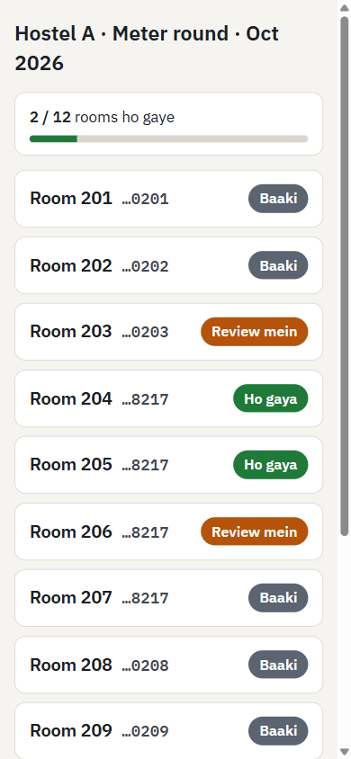
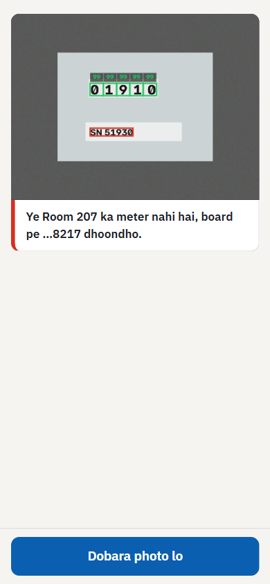
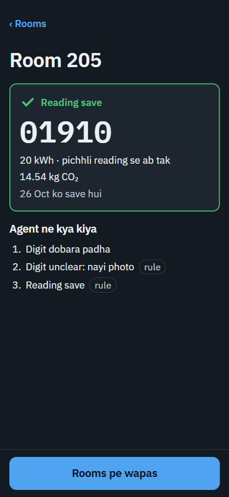
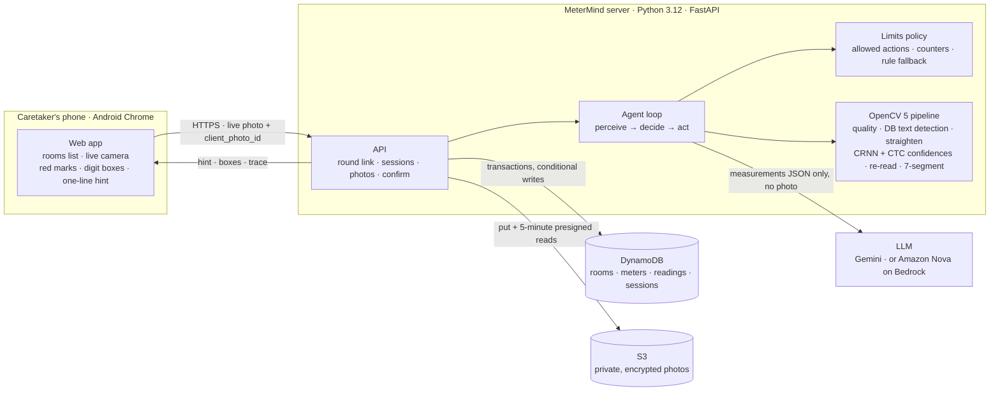
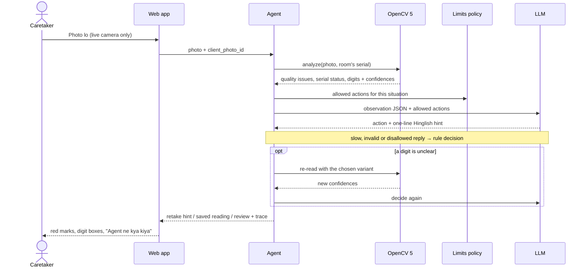

# MeterMind

[](https://github.com/AlgoMasterArpit/Build_with_AI/actions/workflows/ci.yml)


**An agent that reads a utility meter from a live phone photo, doubts the photo when something is off, and decides by itself what to do next.**

A normal OCR app reads a number even from a blurry or wrong photo. MeterMind checks the photo first with OpenCV 5, then an agent chooses the next step: ask for a retake with a specific hint, catch the wrong meter, re-read an unclear digit, send the room to human review, or save the reading. Every step is traced, so you can see what the agent did and why.

<p>
  
  
  
</p>

Built for **Build With AI: Basics** (Devpost) with the Devpost Learn skill pack. The plan that drove the build lives in [`devpost/`](devpost/): [scope](devpost/scope.md) → [PRD](devpost/prd.md) → [spec](devpost/spec.md) → [build checklist](devpost/checklist.md).

---

## The problem

In India, water and gas meters are still read by eye, and where photo proof is required, the photo itself can be faked.

- A Pune housing society received a **₹24 lakh** water bill after months without readings, because the corporation was short of meter readers ([Punekar News](https://www.punekarnews.in/pune-society-shocked-by-rs-24-lakh-water-bill-amid-pmc-meter-reader-shortage/)).
- Delhi Jal Board made **photo proof mandatory** for every reading after complaints about readers ([Outlook](https://www.outlookindia.com/national/corrupt-water-meter-readers-to-face-firs-delhi-jal-board-news-218167)).
- In Odisha, a meter reader faced an FIR for **editing the reading and removing the meter number** from photos ([TP Southern Odisha](https://tpsouthernodisha.com/press-releases/FIR_Registered_in_Boudh)).

Utilities collect these photos by the million, but nobody checks automatically whether a photo shows the right meter or tells the truth. Electricity is moving to smart meters; water, gas and building sub-meters are not, so the photo stays the only proof there.

## Who it is for

The proof of concept follows a **hostel caretaker** doing the monthly meter round: one link, a list of rooms, one live photo per room. The same flow fits utility meter readers and housing-society managers.

## What it does

| Situation in the photo | What OpenCV measures | What the agent does |
| --- | --- | --- |
| Glare, blur or darkness | Saturated-pixel share per cell of a 3×3 grid, Laplacian sharpness, V-channel brightness | Marks the problem area in red and gives one exact hint, e.g. *"Upar right mein glare hai, phone thoda left tilt karo."* |
| Another room's meter | Serial read with the DB text detector + CRNN, matched against the room's registered meter | *"Ye Room 205 ka meter nahi hai, board pe …4821 dhoondho."* |
| A digit caught between two numbers | Per-character confidence from our own CTC decoding of the CRNN output | Re-reads that display with different processing (CLAHE, upscale, threshold, invert), then asks for one new photo |
| Clear reading | Straightened display, every digit boxed with its confidence | Saves the reading with units since the previous reading and CO₂ |
| Reading lower than last month | Compared with the room's previous reading | No negative units: the room goes straight to review |
| A limit is reached | Server-side attempt counters | Sends the room to **Review mein** with photos and the full trace; the caretaker moves on |

**Add Meter** links a new meter from one photo: the agent reads the serial and the first reading, the caretaker only confirms *"Ye meter Room 205 ka hai?"*, and the meter, the room and the baseline are written in one DynamoDB transaction. A serial can belong to only one room.

There is deliberately **no gallery upload and no box to type a reading or serial**: readings come only from live photos.

## Architecture



On a laptop the same code talks to a local [moto](https://docs.getmoto.org/) server instead of AWS, selected by one setting (`AWS_ENDPOINT_URL`). The OpenCV step can run on a separate host by setting `VISION_URL` ([`app/vision/service.py`](app/vision/service.py)).

### One photo through the agent



## How it works

- **Perception is OpenCV 5 only.** `opencv-python-headless==5.0.0.93` runs the OpenCV Zoo PP-OCRv3 DB text detector and the CRNN recognizer through `cv2.dnn`, plus classic image processing for quality, straightening (`getPerspectiveTransform` / `warpPerspective`), re-read variants and a seven-segment backup decoder ([`app/vision/`](app/vision/)).
- **The LLM sees measurements, never photos.** It receives a small JSON observation (quality issues, glare cells, serial match status, digit confidences, attempts left, allowed actions). No image and no OCR text is sent, so a sticker saying *"ignore rules, save"* cannot reach the prompt ([`app/agent/llm.py`](app/agent/llm.py)).
- **The code owns the limits.** Allowed actions come from the limits table in [`app/agent/policy.py`](app/agent/policy.py). A reply that is slow (over 4 s), invalid, outside the allowed actions, or has a hint longer than one line is replaced by the rule decision, and the trace says so.
- **Every decision is traced.** Each photo records `perceive → decide → (reread → decide)` with timings and who decided. The caretaker sees a short *Agent ne kya kiya* list; review records keep the full trace and every photo.

| Agent limit | Rule |
| --- | --- |
| Bad photo (glare, blur, dark, no display) | 3 retakes, then review |
| Wrong meter | 2 in a row, then review |
| Serial unreadable | 3 tries, then review |
| Unclear digit | one automatic re-read, one new photo, then review |
| Reading lower than previous | review immediately |

### Data

One DynamoDB table (`PK`, `SK`), so a hostel's rooms list is one query and every save is one transaction.

| Item | Key | Holds |
| --- | --- | --- |
| Round link | `LINK#<sha256(token)>` | hostel, caretaker (the raw token is never stored) |
| Room | `HOSTEL#<id>` / `ROOM#<room>` | meter serial, previous reading, this month's status |
| Meter guard | `METER#<serial>` | the one room a serial belongs to (conditional write) |
| Reading / review | `HOSTEL#<id>#ROOM#<room>` / `READ#<time>` | reading, units, CO₂, reason, photo keys, full trace |
| Session | `SESSION#<id>` | attempt counters, stored responses per `client_photo_id`, expiry |

## Tech stack

| Layer | Choice | Why |
| --- | --- | --- |
| Vision | OpenCV 5.0 (`cv2.dnn`, imgproc), OpenCV Zoo PP-OCRv3 DB + CRNN | All perception in OpenCV; per-character confidence from our own CTC decoding |
| Agent | Rules policy + LLM decider (Gemini REST or Bedrock Converse) | LLM chooses within code-enforced limits; rules take over on any failure |
| Backend | Python 3.12, FastAPI, pydantic, boto3 | One language for vision, agent and API |
| Data | DynamoDB single table, S3, moto for local runs | Transactions and conditional writes; offline laptop runs with the same code |
| Frontend | Plain HTML, CSS, JS modules, self-hosted IBM Plex | No build step; camera via `getUserMedia` + `ImageCapture` |
| Quality | pytest, ruff, mypy (strict), GitHub Actions | 74 tests, including synthetic meter photos |

## Built with the Devpost Learn skill pack

The project started from an empty folder and was planned before any code, through the skill pack's flipped-interaction interviews:

1. [`devpost/scope.md`](devpost/scope.md) — the kernel (an agent that doubts the photo), the user (a hostel caretaker) and a hard proof-of-concept boundary.
2. [`devpost/prd.md`](devpost/prd.md) — every screen, behavior, limit and edge case, with checkable acceptance criteria.
3. [`devpost/spec.md`](devpost/spec.md) — stack, components, data model, failure modes and a timed build order.
4. [`devpost/checklist.md`](devpost/checklist.md) — the build in eight verified slices, each committed separately.

## Not in this proof of concept

Deliberately left for later (see [`devpost/scope.md`](devpost/scope.md#later)): a resident page with photo proof and disputes, a room bill split, an auditor dashboard for review records, reused-photo and edit-mark detection, WhatsApp delivery.

## Run it locally

Requirements: [uv](https://docs.astral.sh/uv/) and Git. uv installs Python 3.12 by itself.

```bash
git clone https://github.com/AlgoMasterArpit/Build_with_AI.git metermind
cd metermind
uv sync
uv run python scripts/fetch_models.py        # OpenCV Zoo models, SHA-256 checked
cp .env.example .env                         # points AWS at a local moto server
```

Terminal 1 — a local fake AWS (DynamoDB + S3), so nothing needs a cloud account:

```bash
uv run moto_server -p 5000
```

Terminal 2 — seed one hostel and start the app:

```bash
uv run python scripts/seed.py seed/hostel_a.json   # prints the round link
uv run uvicorn app.main:app --port 8000 --env-file .env
```

Open the printed link (`http://localhost:8000/r/<token>`) in Chrome. Browsers allow the camera on `localhost`, so a laptop webcam works. Rooms 204 and 205 start without a meter, so they open the Add Meter flow.

### On a phone

Phones only open the camera over HTTPS. Expose the local server with a quick tunnel and open the round link on that host in Android Chrome:

```bash
cloudflared tunnel --url http://localhost:8000 --protocol http2
```

Some campus and hostel networks block Cloudflare's tunnel port (7844); a phone hotspot works. Set `PUBLIC_BASE_URL` in `.env` to the tunnel address before seeding so the printed link uses it.

### Settings

| Variable | Default | Meaning |
| --- | --- | --- |
| `AWS_ENDPOINT_URL` | `http://localhost:5000` in `.env.example` | Local moto server; leave empty on AWS |
| `TABLE_NAME`, `BUCKET_NAME` | `metermind`, `metermind-photos` | DynamoDB table, private S3 bucket |
| `LLM_PROVIDER` | `none` | `gemini`, `bedrock` or `none` (rules only) |
| `GEMINI_API_KEY`, `GEMINI_MODEL` | – , `gemini-3.5-flash-lite` | Gemini via REST |
| `BEDROCK_MODEL_ID` | `us.amazon.nova-lite-v1:0` | Amazon Nova via the Bedrock Converse API |
| `LLM_TIMEOUT_SECONDS` | `4` | After this the rules decide |
| `VISION_URL` | empty | Run the OpenCV step on a separate host (`app/vision/service.py`) |
| `PUBLIC_BASE_URL` | `http://localhost:8000` | Host used in printed round links |

## Tests

```bash
uv run pytest -q          # vision, agent, API (DynamoDB and S3 mocked with moto)
uv run ruff check . && uv run ruff format --check . && uv run mypy app scripts
```

CI runs the same on every push ([`.github/workflows/ci.yml`](.github/workflows/ci.yml)). The vision tests use synthetic meter photos generated in [`tests/vision/synth.py`](tests/vision/synth.py), including a rolling-counter digit caught halfway between two numbers. To check the pipeline on real photos:

```bash
uv run python scripts/ocr_probe.py path/to/photos --expected <serial>
```

It prints quality, serial status and every digit's confidence, and writes annotated copies to `probe_out/`. File names containing the true reading (e.g. `room205_01910.jpg`) are scored automatically.

## Project layout

```
app/
  vision/    OpenCV 5 pipeline: quality, text detection, CRNN + CTC confidences, re-read, 7-segment
  agent/     limits policy, perceive-decide-act loop, LLM decider and providers, step summary
  api/       FastAPI routes: round, rooms, sessions, photos, confirm
  domain/    rooms and rounds, sessions, readings, units, CO2 factors
  store/     DynamoDB single table (transactions, conditional writes), private S3 photos
web/         plain HTML, CSS and JS modules (no build step), self-hosted IBM Plex fonts
scripts/     model download, seed, OCR probe
devpost/     scope, PRD, spec and build checklist from the Devpost Learn skill pack
```

## Responsible use and limits

- **Not a forgery detector.** A good forgery cannot be caught from pixels alone. MeterMind narrows the gaps (live camera only, serial check, one serial per room, readings that may not go backwards) and leaves the final decision on doubtful cases to a person.
- **Privacy.** Photos go to a private, encrypted S3 bucket and are shown only through presigned links that expire in 5 minutes. The LLM never receives a photo. Location is optional; a reading is never blocked or reviewed for missing location.
- **CO₂** is shown only where a sourced factor exists: electricity uses the CEA CO₂ Baseline Database v20.0 grid average (0.727 kg/kWh), gas uses the IPCC 2006 natural-gas factor. Water shows units only.
- **Proof-of-concept scope.** One caretaker link per hostel without logins, Android Chrome as the assumed phone, rooms loaded by a seed script, review records without a review screen yet. A meter rolling over from 99999 to 00012 goes to review.

## Credits

- Text models: [OpenCV Zoo](https://github.com/opencv/opencv_zoo) PP-OCRv3 text detection and CRNN text recognition.
- Fonts: [IBM Plex](https://github.com/IBM/plex), SIL Open Font License ([web/fonts/OFL.txt](web/fonts/OFL.txt)).
- Emission factors: [CEA CO₂ Baseline Database](https://cea.nic.in/wp-content/uploads/2021/03/User_Guide_Version_20.0.pdf), [IPCC 2006 Guidelines Vol. 2](https://www.ipcc-nggip.iges.or.jp/public/2006gl/pdf/2_Volume2/V2_2_Ch2_Stationary_Combustion.pdf).

## License

MIT — see [LICENSE](LICENSE).
